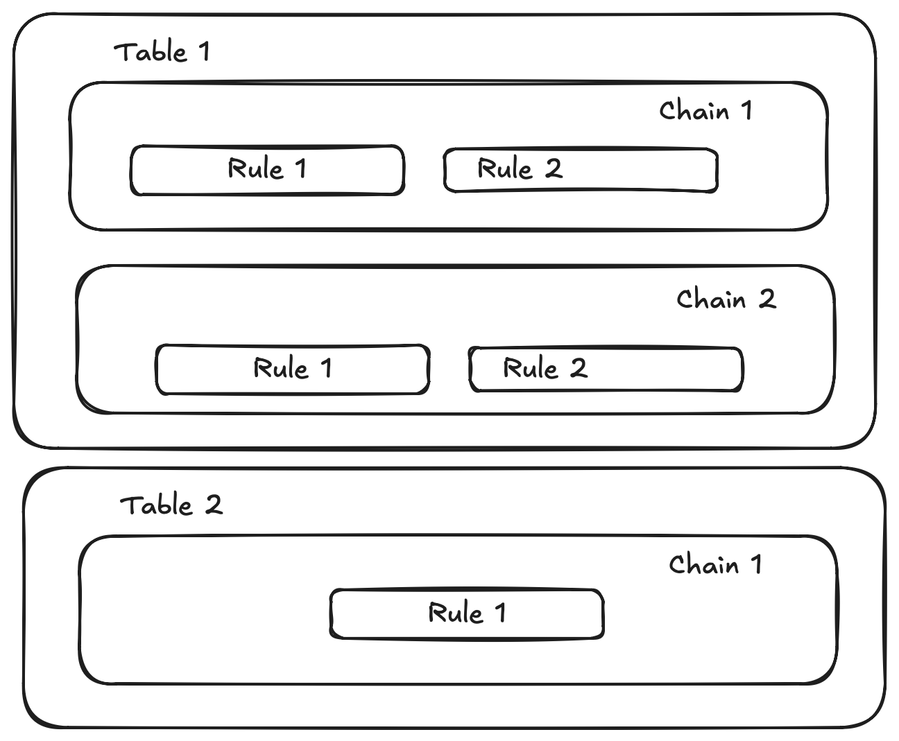

## Intro

This is the second article of a [three part series](../self_hosting/index.md) which explains how to expose a self hosted service to the public Internet.  I will discuss basic IP forwarding, routing on the host, and using nftables to implement firewall filters and Network Address Translation (NAT).

## Setup

This post builds upon the [first article](../bridges/index.md) describing how bridges are used to setup L2 networking.  Scripts are provided to [recreate the L2 environment](./assets/setup-bridge.sh) on the host and to [start the Alpine Linux guest](./assets/start-vm.sh).  The guest VM startup script will need to be modified to match the [downloaded Alpine image](https://alpinelinux.org/downloads/).  These [network commands](./assets/vm-networking.sh) will help with configuring the Alpine Linux guest VM for this article.

The host is located inside my Local Area Network and does not have a direct connection to the Internet.  Host network links should look something like this after running the setup-bridge.sh script.

```shell
# Display the host's physical connection to the network.
# The device enp0s1 name may be different with your instance

hostOS $ ip link show
1: lo: <LOOPBACK,UP,LOWER_UP> mtu 65536 qdisc noqueue state UNKNOWN mode DEFAULT group default qlen 1000
    link/loopback 00:00:00:00:00:00 brd 00:00:00:00:00:00
2: enp0s1: <BROADCAST,MULTICAST,UP,LOWER_UP> mtu 1500 qdisc pfifo_fast state UP mode DEFAULT group default qlen 1000
    link/ether 52:54:00:26:9b:b1 brd ff:ff:ff:ff:ff:ff
    altname enx525400269bb1
3: br0: <BROADCAST,MULTICAST,UP,LOWER_UP> mtu 1500 qdisc noqueue state UP mode DEFAULT group default qlen 1000
    link/ether b2:3d:68:20:4b:a4 brd ff:ff:ff:ff:ff:ff
4: tap0: <BROADCAST,MULTICAST,UP,LOWER_UP> mtu 1500 qdisc fq_codel master br0 state UP mode DEFAULT group default qlen 1000
    link/ether 2a:cb:10:43:21:84 brd ff:ff:ff:ff:ff:ff

# Display bridge IP

hostOS $ ip -4 address show  br0
3: br0: <BROADCAST,MULTICAST,UP,LOWER_UP> mtu 1500 qdisc noqueue state UP group default qlen 1000
    inet 192.168.100.1/24 scope global br0
       valid_lft forever preferred_lft forever
```

enp0s1 is my host's physical network interface and could be different.  br0 is the bridge interface. tap0 is attached to the br0 bridge and used by the guest VM.

## IP Packet forwarding

In the first article a VM was attached to a L2 network with IP addresses assigned.  The VM could ping interfaces on the host but nothing off the host.  The first step in allowing off host access is to enable L3 packet forwarding between interfaces.

We can use tcpdump to see what happens when packet forwarding is not enabled and the guest VM attempts to ping Google's DNS servers at 8.8.8.8:

```shell
# What the VM receives
guestVM:~# ping -c 2 8.8.8.8
PING 8.8.8.8 (8.8.8.8): 56 data bytes

--- 8.8.8.8 ping statistics ---
2 packets transmitted, 0 packets received, 100% packet loss
```

We expect to see ICMP traffic on the host's bridge interface as that's where the tap device is attached.

```shell
# ICMP traffic is present on the bridge. This is good.
hostOS $ sudo tcpdump -n -i br0 icmp
tcpdump: verbose output suppressed, use -v[v]... for full protocol decode
listening on br0, link-type EN10MB (Ethernet), snapshot length 262144 bytes
15:17:21.781742 IP 192.168.100.2 > 8.8.8.8: ICMP echo request, id 2480, seq 0, length 64
15:17:22.787296 IP 192.168.100.2 > 8.8.8.8: ICMP echo request, id 2480, seq 1, length 64
```

We also expect to see ICMP traffic from the bridge to the host's physical network interface, but ICMP traffic isn't appearing.

```shell
# ICMP traffic is absent from the host's network interface. Not what we want.
hostOS $ sudo tcpdump -n -i enp0s1  icmp
tcpdump: verbose output suppressed, use -v[v]... for full protocol decode
listening on enp0s1, link-type EN10MB (Ethernet), snapshot length 262144 bytes
^C
0 packets captured
0 packets received by filter
0 packets dropped by kernel
```

To forward traffic from the bridge (br0) to the host's network interface (enp0s1) we need to enable IP packet forwarding between all interfaces.  Once forwarding is enabled, ICMP traffic appears on both interfaces as the host is now able to forward packets between the bridge and its physical network interface.  

Enabling forwarding is a simple one line command. The change isn't persistent and will get replaced with system defaults when the host gets rebooted.

```
# To print the current state of packet forwarding, 0 is false 1 is true.
hostOS $ sysctl net.ipv4.ip_forward
net.ipv4.ip_forward = 0

# To enable packet forwarding between interfaces
hostOS $ sudo sysctl -w net.ipv4.ip_forward=1
net.ipv4.ip_forward = 1
```

Now that packet forwarding is enabled, ICMP traffic is present on enp0s1.

```
# ICMP traffic is now present on the host's network interface
hostOS $ sudo tcpdump -n -i enp0s1  icmp
tcpdump: verbose output suppressed, use -v[v]... for full protocol decode
listening on enp0s1, link-type EN10MB (Ethernet), snapshot length 262144 bytes
15:24:03.289795 IP 192.168.100.2 > 8.8.8.8: ICMP echo request, id 2481, seq 0, length 64
15:24:04.333550 IP 192.168.100.2 > 8.8.8.8: ICMP echo request, id 2481, seq 1, length 64
```

## Network Address Translation 

Even with IP forwarding enabled, the VM still shows a failed ping attempt to off host networks.

```shell
guestVM:~# ping -c 2 8.8.8.8
PING 8.8.8.8 (8.8.8.8): 56 data bytes                                                                  

--- 8.8.8.8 ping statistics ---
2 packets transmitted, 0 packets received, 100% packet loss
```

If we look at guest VM traffic passing from the host to the router, the router sees the guest VM's address, not the host's.  The router doesn't have a route to the VM guest network so it doesn't know where to send replies.  SNAT on the host makes the return path possible without adding a route to the upstream router.

```
# tcpdump taken on the router upstream from the guest VM and host OS.
% sudo tcpdump -n -i bridge100 icmp 
Password:
tcpdump: verbose output suppressed, use -v[v]... for full protocol decode
listening on bridge100, link-type EN10MB (Ethernet), snapshot length 524288 bytes
16:13:32.317662 IP 192.168.100.2 > 8.8.8.8: ICMP echo request, id 2486, seq 0, length 64
16:13:33.295881 IP 192.168.100.2 > 8.8.8.8: ICMP echo request, id 2486, seq 1, length 64
```

This is why Docker and Podman typically use source NAT (SNAT) with bridged networks. The source address in the IP packet needs to be changed from the container or guest VM to the IP address of the host's network adapter.

## nftables

### Overview

nftables provides Linux's packet filtering and network address translation framework.  nftable configurations are organized by tables, chains, and rules. `tables` contain `chains` and chains contain `rules`.  Rules define packet matching criteria and what actions to take when those packets match.



The table family determines which network protocols the table can process. The `ip` family handles IPv4, `ip6` handles IPv6, and `inet` supports both IPv4 and IPv6.

| Table Family | Traffic Match |
| --- | --- |
| `ip` | IPv4 traffic |
| `ip6` | IPv6 traffic |
| `inet` | Both IPv4 and IPv6 traffic |

Chains attach to `hooks`. Individual hooks associate to network packets during a particular stage of packet processing. The rules within that chain are then applied to those network packets associated with the attached hook.  I only mention the few hooks used in this series, but there are [additional hooks](https://wiki.nftables.org/wiki-nftables/index.php/Netfilter_hooks).  

| Hook Name  | Description |
| --- | --- |
| prerouting | Used for early filtering and destination NAT |
| input | Packets whose destination is the local host system. Protects the host itself. |
| forward | Packets passing through the host from one network interface to another. (A running VM.) Controls what gets passed through.| 
| output | locally generated packets originating from processes running on the host OS itself, before egress. |
| postrouting |  Final stage for all outgoing packets. Used for Masquerade or source NAT |

Hooks have a priority where lower priority values are processed first.

| Priority Name | Description | Value |
| --- | --- | --- |
| dstnat | Destination NAT | -100 |
| filter | Filtering operation | 0 |
| srcnat | Source NAT | 100 |

I'm using a single hook within each chain for simplicity.  Mixing multiple chains and priorities can make diagnosing ordering issues challenging.

### Source NAT Demo

Let's apply what we've learned about nftables to allow our VM access to off host networks.  Start by opening a file editor and defining a table containing a chain attached to the `postrouting` hook. A NAT rule is then added to the chain.

```shell
hostOS $ cat nftables.nat 
#!/usr/sbin/nft -f

# Flush existing ruleset for a clean state. 
# WARNING: This removes the existing nftables ruleset. Only use this on the disposable/demo host.
flush ruleset

# Define a table of type "ip" for ipv4 traffic and give it the name "nat".
table ip nat {
        # Define a chain to contain rules, (chain MYNAMEDCHAIN).
        chain POSTROUTING {
                # apply the postrouting hook to this chain to enable snat (MASQUERADE)
                # "policy accept" allows permits any traffic not matched by rules in this chain
                type nat hook postrouting priority srcnat; policy accept;

                # Masquerade outbound traffic from the VM out through enp0s1
                ip saddr 192.168.100.0/24 oifname "enp0s1" masquerade
        }
}
```

Apply this nftable definition with the `nft` command.

```shell
# Flush all existing rules and apply our masquerade changes
hostOS $ sudo nft -f ./nftables.nat

# List the applied changes.
hostOS $ sudo nft list ruleset
table ip nat {
        chain POSTROUTING {
                type nat hook postrouting priority srcnat; policy accept;
                ip saddr 192.168.100.0/24 oifname "enp0s1" masquerade
        }
}
```

Go back to our guest VM and try pinging 8.8.8.8 again.  It works this time.

```shell
guestVM:~# ping -c 1 8.8.8.8 
PING 8.8.8.8 (8.8.8.8): 56 data bytes
64 bytes from 8.8.8.8: seq=0 ttl=114 time=100.303 ms

--- 8.8.8.8 ping statistics ---
1 packets transmitted, 1 packets received, 0% packet loss
round-trip min/avg/max = 100.303/100.303/100.303 ms
```

If we run tcpdump on the bridge when the guest VM is pinging 8.8.8.8, we'll see the guest VM's IP address.

```shell
hostOS $ sudo tcpdump -n -i br0 icmp
tcpdump: verbose output suppressed, use -v[v]... for full protocol decode
listening on br0, link-type EN10MB (Ethernet), snapshot length 262144 bytes
06:39:35.344098 IP 192.168.100.2 > 8.8.8.8: ICMP echo request, id 2491, seq 0, length 64
06:39:35.434570 IP 8.8.8.8 > 192.168.100.2: ICMP echo reply, id 2491, seq 0, length 64
```

But on the host's network interface, the source IP has been switched from the guest VM's IP at 192.168.100.2 to the host's IP at 192.168.252.12.  This verifies NAT is working as expected.

```shell
hostOS $ sudo tcpdump -n -i enp0s1  icmp
tcpdump: verbose output suppressed, use -v[v]... for full protocol decode
listening on enp0s1, link-type EN10MB (Ethernet), snapshot length 262144 bytes
06:39:35.344297 IP 192.168.252.12 > 8.8.8.8: ICMP echo request, id 2491, seq 0, length 64
06:39:35.434466 IP 8.8.8.8 > 192.168.252.12: ICMP echo reply, id 2491, seq 0, length 64
```

We can also verify by checking the netfilter connection tracking table with the conntrack command.

```shell
hostOS $ sudo conntrack -L -s 192.168.100.2 
icmp     1 17 src=192.168.100.2 dst=8.8.8.8 type=8 code=0 id=2494 src=8.8.8.8 dst=192.168.252.12 type=0 code=0 id=2494 mark=0 use=1
```

### Port forwarding / Destination NAT Demo

Let's continue building on the source NAT demo by exposing a service from the guest VM to external networks.  The demo will use netcat as the service exposed to external networks on TCP port 8080. Netcat was chosen because the guest VM is somewhat minimal.

```shell
guestVM:~# nc -lk  -p 8080 -e echo "GREETINGS FROM THE GUEST VM" 
```

Let's update our nftables config by adding a chain with a `prerouting` hook.  Prerouting processes packets before the routing decision. The routing decision determines if a packet is delivered locally through the `input` hook or forwarded to another network through the `forward` hook.

In this example, VM bound traffic passes from the prerouting hook to the forward hook.  The forward hook doesn't have any defined rules, meaning nftables does not block those packets and traffic passes onto the guest VM.

The postrouting rule stays the same as from earlier.

```shell
hostOS $ cat nftables.nat 
#!/usr/sbin/nft -f

# Flush existing ruleset for a clean state. 
# WARNING: This removes the existing nftables ruleset. Only use this on the disposable/demo host.
flush ruleset

table ip nat {
        chain PREROUTING {
                type nat hook prerouting priority dstnat; policy accept;

                # Forward port 8080 hitting enp0s1 directly to the guest VM
                iifname "enp0s1" tcp dport 8080 dnat to 192.168.100.2
        }

        chain POSTROUTING {
                type nat hook postrouting priority srcnat; policy accept;

                # Masquerade outbound traffic from the VM out through enp0s1
                ip saddr 192.168.100.0/24 oifname "enp0s1" masquerade
        }
}
```

Apply the rules with `nft -f nftables.nat`.  Once applied, the guest VM's service on port 8080 is reachable by other hosts.

```
my_laptop $ nc -v 192.168.252.12 8080     
Connection to 192.168.252.12 port 8080 [tcp/http-alt] succeeded!
GREETINGS FROM THE GUEST VM
```

### Connection Tracking

The Linux kernel uses connection tracking (`conntrack`) for associating packets with network connections and tracking connection state. nftables can use the conntrack information to implement a stateful firewall that applies different rules to new connections and traffic belonging to existing connections.

nftables rules starting with `ct` are referencing conntrack state in the kernel.  The `ct state established,related accept` rule allows packets belonging to established connections and related traffic. When the guest VM initiates an outbound connection, this rule allows reply traffic back through the firewall without allowing new unsolicited inbound connections.

Using connection tracking information lets the firewall make decisions based on connections state instead of treating every packet independently.

### Filtering Demo

The final demo explores filtering traffic to the host. Let's say the host is running sshd and we want to prevent external network requests from connecting to TCP port 22 on the host, but I still want to allow my laptop at 192.168.252.1/32 host access. This is where we utilize the `input`, `output`, and `forward` hooks in our chain definitions.

```shell
#!/usr/sbin/nft -f

# Flush existing ruleset for a clean state. 
# WARNING: This removes the existing nftables ruleset. Only use this on the disposable/demo host.
flush ruleset

# ------------------------------------------------------------------
# Table 1: Filtering (New content for Host & VM Transit)
# ------------------------------------------------------------------
table ip filter {
	chain input {
                # The input hook is for traffic to the host
		type filter hook input priority filter; policy drop;
                
                # iifname matches against "Input INterface Name" matching lo
		# Allow internal loopback traffic
		iifname "lo" accept

                # CT is the "Connection Tracking" feature described earlier.
		# Allow established and related connections (return traffic to host)
		ct state established,related accept

                # Filter traffic arriving on host's physical network connection "enp0s1"
                # Allow SSH management to the host OS (Port 22) if src IP is my laptop.
                # My laptop is 192.168.252.1/32. 
                # If your laptop has a different IP, you will lose SSH access to the host.
                iifname "enp0s1" ip saddr 192.168.252.1/32 tcp dport 22 accept

		# Allow ICMP/ping for host diagnostics
		ip protocol icmp accept
	}

	chain forward {
                # The forward hook is for traffic routing through the host to another network.
                # The other network is our VM in this example
		type filter hook forward priority filter; policy drop;

		# Allow established/related return traffic for the VM
		ct state established,related accept

		# Allow **any** outbound traffic originating from the guest VM
                # Production deployments should restrict destinations or services to guest VM's intended role
		iifname "br0" oifname "enp0s1" ip saddr 192.168.100.2 accept

		# Allow forwarded HTTP and HTTPS traffic reaching the VM
                # oifname matches "Output INterface Name" matching br0
		oifname "br0" ip daddr 192.168.100.2 tcp dport 8080 accept
	}

	chain output {
		# This allows all outbound traffic from the host, not the guest VM.
                type filter hook output priority filter; policy accept;
	}
}

# ------------------------------------------------------------------
# Table 2: Previously Defined - NAT (Port Forwarding & Egress Masquerade)
# ------------------------------------------------------------------
table ip nat {
        # IP is IPv4 only
	chain PREROUTING {
                # The prerouting hook processes packets before routing to input or forward stages
                type nat hook prerouting priority dstnat; policy accept;

		# Forward HTTP/HTTPS hitting enp0s1 directly to the Alpine VM
		iifname "enp0s1" tcp dport 8080 dnat to 192.168.100.2
	}

	chain POSTROUTING {
                # The postrouting hook processes packets after the output hook routing decision
		type nat hook postrouting priority srcnat; policy accept;

		# Masquerade outbound traffic from the VM out through enp0s1
		ip saddr 192.168.100.0/24 oifname "enp0s1" masquerade
	}
}
```

After applying the rules we see both port 22 and 8080 are reachable by my laptop at 192.168.252.1/32.

```shell
my_laptop $  nc -v 192.168.252.12 22  
Connection to 192.168.252.12 port 22 [tcp/ssh] succeeded!
SSH-2.0-OpenSSH_10.2p1 Ubuntu-2ubuntu3.6
^C

my_laptop $  nc -v 192.168.252.12 8080
Connection to 192.168.252.12 port 8080 [tcp/http-alt] succeeded!
GREETINGS FROM THE GUEST VM
```

### Recap

This has been a short intro to get started with host level routing and nftables. Understanding that traffic destined for a container or VM will pass through forward and prerouting hooks instead of the input hook explains why protecting the host and forwarded traffic require separate sets of rules.  It's why I recommend learning more about [nftables](https://wiki.nftables.org/wiki-nftables/index.php/Main_Page).

The third article will apply this information to a deployment model for self hosting a local service on the public Internet.  For update notifications on this series, either subscribe to the [RSS feed](/articles/index.xml) or follow along on my [Bluesky account](https://bsky.app/profile/af9.us).
